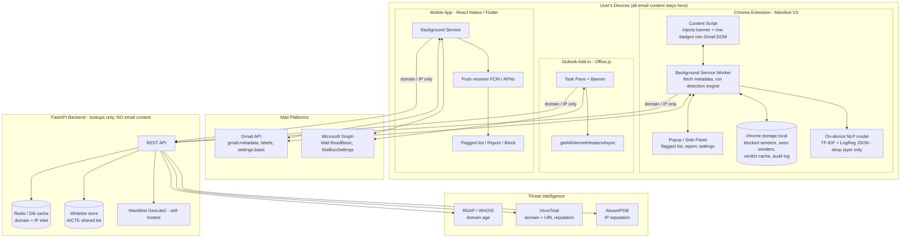
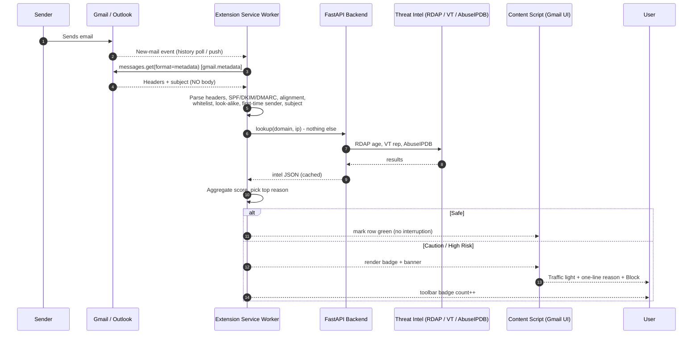
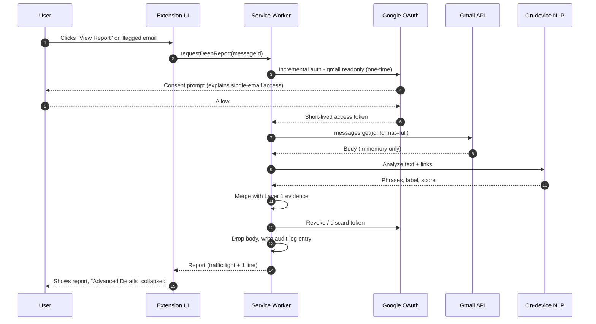
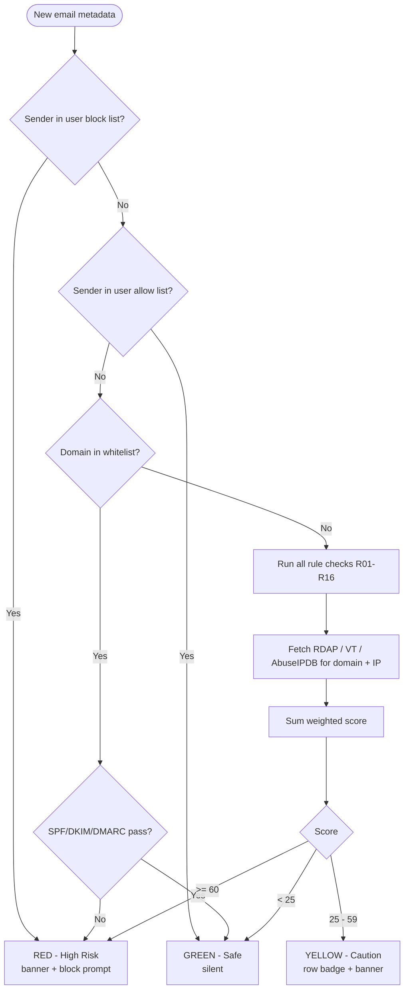
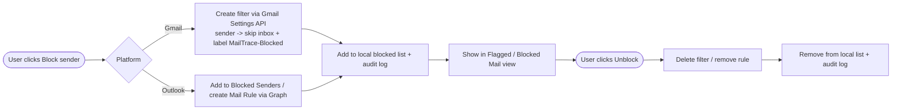
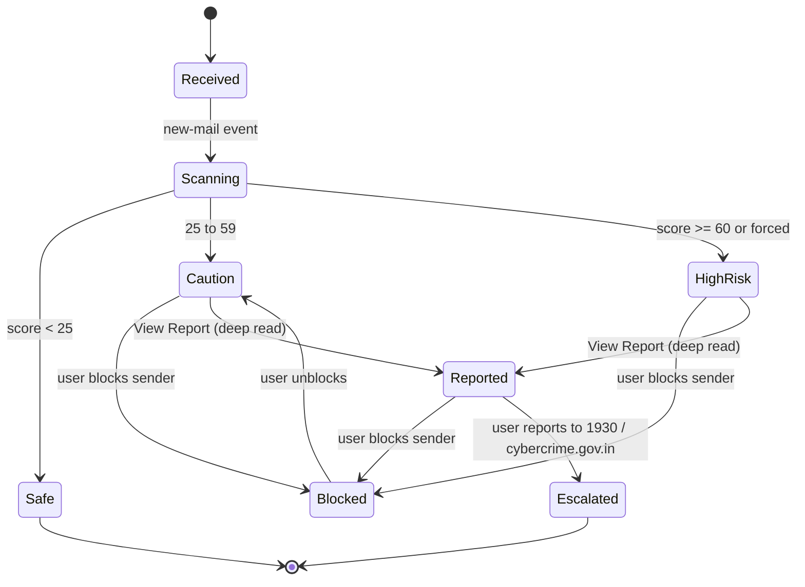
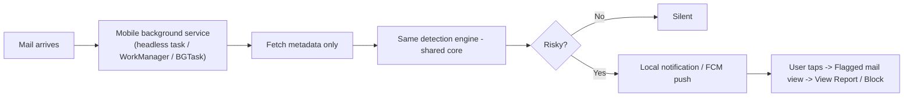
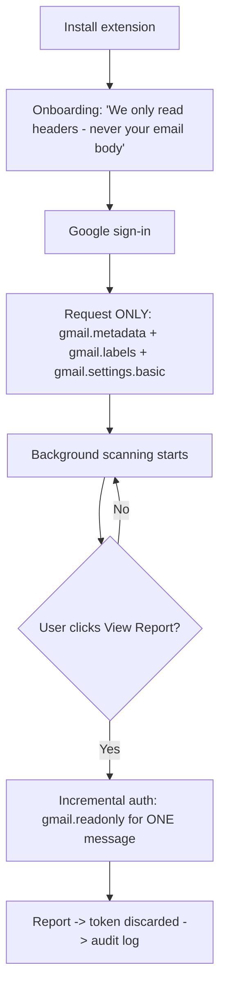

# MailTrace AI — Build Specification

> **Smarter Email. Safer You.**
> Privacy-first email threat shield: Chrome extension (Gmail) + Outlook add-in + background mobile app.
> SIH 2026 · Problem Statement 26106 · Team Byte Crew (TS12)

This file is the single source of truth for building the product. It is written so that **you (or an AI coding assistant) can start building from it directly.** Read sections 1–6 for the "what and why", sections 7–12 for the "how", and section 15 for copy-paste build prompts.

---

## Table of Contents

1. [Product Summary](#1-product-summary)
2. [Problem & Impact](#2-problem--impact)
3. [Core Principles (Non-Negotiable)](#3-core-principles-non-negotiable)
4. [How It Works (End-to-End)](#4-how-it-works-end-to-end)
5. [Features](#5-features)
6. [User Experience & Risk Display](#6-user-experience--risk-display)
7. [System Architecture](#7-system-architecture)
8. [Detection Engine](#8-detection-engine)
9. [Flow Diagrams](#9-flow-diagrams)
10. [Permissions & Privacy Enforcement](#10-permissions--privacy-enforcement)
11. [Tech Stack, Data Model & API](#11-tech-stack-data-model--api)
12. [Project Structure](#12-project-structure)
13. [Build Roadmap & Milestones](#13-build-roadmap--milestones)
14. [Demo, Testing & Cost](#14-demo-testing--cost)
15. [Build Prompts (Copy-Paste)](#15-build-prompts-copy-paste)
16. [Branding & Logo](#16-branding--logo)
17. [Known Technical Gotchas](#17-known-technical-gotchas)
18. [Open Questions](#18-open-questions)

---

## 1. Product Summary

**MailTrace AI** scans every incoming email's **sender domain and metadata** in real time, directly inside Gmail, Outlook and on mobile, and flags spoofed or fraudulent senders instantly. **It does not read the email body by default.**

| | |
|---|---|
| **One-line pitch** | *"A privacy-first second layer of email defense that runs where the inbox already lives — no uploads, no inbox body access by default, real-time warnings and blocking, and a full forensic report only when the user asks for one."* |
| **Surfaces** | Chrome extension (Gmail web) · Outlook add-in (Office.js) · Mobile app (Android/iOS, background service) |
| **Primary audience** | Students (AICTE institutions) — secondary: institution admins / cyber-cell analysts |
| **Key differentiator** | Metadata-only by default, enforced by OAuth scope — not just by policy. Deep read is one-time, per email, user-triggered. |
| **Pivot** | Originally a website where users uploaded/forwarded suspicious emails → now automatic, in-inbox, zero-friction protection |

### Why this direction is stronger
1. Removes the biggest adoption barrier (manual upload/reporting).
2. Much more defensible privacy story (metadata-only, enforced by scope).
3. Far better live demo: judges see protection happening inside a real inbox.

---

## 2. Problem & Impact

- Phishing and spoofed emails drive **90%+ of cyberattacks** (CISA); most users cannot distinguish a fake sender from a real one.
- Projected cyber-fraud loss in India: **₹1.2 lakh crore (2025, I4C estimate)**.
- **₹11,158 Cr** already saved via the 1930 helpline since 2021 (I4C/PIB, till Jun 2026).
- Reporting within the **"golden hour"** recovers **20–30% more funds**.
- CERT-In handled **29.44 lakh** incidents in 2025.
- Real scenario basis: I4C "Boss Scam" advisory (fake CEO/MD impersonation) and fake internship / fee-due scams targeting students.

**Report-out path:** For confirmed phishing, the app points users to **cybercrime.gov.in / Helpline 1930**.

---

## 3. Core Principles (Non-Negotiable)

| # | Principle | What it means in code |
|---|---|---|
| P1 | **Metadata-only by default** | Request `gmail.metadata` / `Mail.ReadBasic` only. Body fetching code path must be unreachable unless user clicks "View Report". |
| P2 | **Scope-enforced privacy** | Privacy is a property of the OAuth scope, not a promise. Tool is *technically incapable* of reading the body in default mode. |
| P3 | **Incremental authorization** | Elevated read permission requested **only** at the moment of "View Report", for **one email**, no standing access afterward. (Google's recommended pattern — cite it in the pitch.) |
| P4 | **Nothing identifying leaves the device** | Only a **domain** or **IP** goes to the backend for lookups. Never user identity, never email content, never the subject. |
| P5 | **Body is never stored** | Fetched in memory → analyzed → report generated → body discarded. |
| P6 | **Simple by default, deep on demand** | Traffic light + one sentence. Forensics hidden behind collapsed "Advanced Details". |
| P7 | **Silent when safe** | Safe email = no interruption, nothing shown (extension). |
| P8 | **Real platform blocking** | Use native Gmail filters/labels and Outlook Blocked Senders / Mail Rules — not custom hacks. |
| P9 | **Auditable** | Every permission use is logged locally and viewable by the user. |

### The one honest tradeoff (state it openly in the pitch)
Metadata-only is excellent against spoofing, auth failures, and domain fraud. It **cannot** catch a fake-internship email sent from a properly authenticated free address that relies purely on body language. Solution = **two-layer design**, not abandoning privacy:

- **Layer 1 — Always-on, metadata-only**
- **Layer 2 — On-demand, one-time body read**

---

## 4. How It Works (End-to-End)

### 4.1 Plain-language walkthrough

1. **Email arrives** in Gmail/Outlook as normal.
2. **Extension / add-in checks it automatically** in the background: domain whitelist, SPF/DKIM/DMARC, WHOIS/RDAP domain age, sender reputation, subject-line patterns.
3. **Safe** → no interruption, nothing shown.
4. **Risky** → a **warning banner appears directly in the inbox**: traffic light (🔴 / 🟡) + **one plain-language reason** + a **Block sender** option. No scores, no jargon.
5. **Location/origin is deliberately NOT shown** by default. The job here is to warn and protect, not explain.
6. User opens the extension's **Flagged/Blocked Mail** view and clicks an email → **one-time deep-read permission** → simple report (same traffic light + one-line reason).
7. A collapsed **Advanced Details** section holds full forensics: headers, WHOIS, IP origin/geo, confidence score, relay trace, flagged phrases.
8. User can **block / unblock any sender at any time**.

### 4.2 The two layers

| | **Layer 1 — Always-on** | **Layer 2 — On-demand deep layer** |
|---|---|---|
| Trigger | Every new email | User clicks **View Report** on a flagged email |
| Data accessed | Headers + metadata + subject only | That single email's body (one-time) |
| Scope | `gmail.metadata` / `Mail.ReadBasic` | `gmail.readonly` (single message, incremental) / `Mail.Read` (per item) |
| Checks | Whitelist, SPF/DKIM/DMARC, domain age, reputation, look-alike, first-time sender, subject patterns | NLP phishing-language classifier, link extraction + URL reputation, payment-request detection, full forensic report |
| Runs where | Client-side where possible | Client-side (in-extension model) — body never sent to backend |
| Retention | Verdict cached (no content) | **Nothing retained** after report |

### 4.3 Data that leaves the device
Only: **a domain** (for WHOIS/RDAP, VirusTotal, whitelist) or **an IP** (for AbuseIPDB, GeoIP). Never user identity, never the email.

---

## 5. Features

### 5.1 MVP (must be in the SIH demo)

#### Chrome Extension (Gmail)
- [ ] Gmail OAuth login with **metadata-only** scope.
- [ ] Automatic real-time scanning of new incoming mail (no upload).
- [ ] In-inbox **warning banner** injected into Gmail UI (content script) with 🔴/🟡 + one-line reason + **Block sender** button.
- [ ] Inbox **row badge** (dot + small label) on each scanned mail: 🔴 *Suspicious – spoofed domain*, 🟡 *Verify sender*, 🟢 *Safe – verified*. (Matches the deck's Gmail mockup.)
- [ ] **Side panel / popup** "MailTrace AI": scan summary ("3 emails analyzed — 1 Suspicious, 1 Needs verification, 1 Safe") + "We only analyze metadata" privacy card.
- [ ] **Flagged / Blocked Mail** panel listing all emails acted on.
- [ ] **View Report** → one-time deep-read permission → simple report + collapsed **Advanced Details**.
- [ ] **Block / Unblock sender** using real Gmail filters/labels.
- [ ] Toolbar **badge count** of flagged emails.
- [ ] **Test-drive mode** with bundled sample scam emails (for demo + training).

#### Outlook Add-in (Office.js)
- [ ] Same warning-banner pattern in Outlook web/desktop task pane.
- [ ] Reads headers via Office.js (`getAllInternetHeadersAsync`) → same detection engine.
- [ ] Block via Outlook Blocked Senders / Mail Rules (Graph).

#### Mobile App (Android/iOS)
- [ ] Install once, **background service** — protection works without opening the app.
- [ ] Same metadata-only pipeline, same Gmail/Outlook account.
- [ ] **Push notification** (FCM/APNs) the moment a risky email is detected.
- [ ] Flagged mail list, traffic-light report, Advanced Details, block/unblock.

#### Backend (minimal, FastAPI)
- [ ] Domain intelligence (RDAP age, VirusTotal, whitelist).
- [ ] IP intelligence (AbuseIPDB, MaxMind GeoLite2).
- [ ] Caching + rate-limit protection.
- [ ] **No user email content ever reaches it.**

### 5.2 Tiering (from deck — Viability slide)

| Tier | Who | Price | What they get |
|---|---|---|---|
| **Free — Students** | Students | ₹0 (entire education career) | Full flag protection (🔴🟡🟢), basic reason report |
| **Free — Basic** | Low-volume individuals | ₹0 | Green/yellow/red flags, basic reason report, **no location / heavy-API data** |
| **Premium** | High-volume users, companies (custom) | **₹99/month** | **Full report:** sender GeoIP location + forensic breakdown |

Break-even: ~**192 premium subscribers × ₹99 ≈ ₹19,000/month** covers growth-tier infra cost. National tier scales to ~₹1.4–1.5 L/month.

> ⚠️ Implementation note: gate "Advanced Details → GeoIP location + forensic breakdown" behind a `plan` flag (`free | premium`). For the hackathon demo, ship with a **demo toggle** that enables premium.

### 5.3 Roadmap features (design for, build later)

**Detection**
- QR-code / image phishing (decode QR → check URL)
- Homoglyph / typosquat look-alike detection (note: a basic version is in MVP — see §8)
- Attachment-name red flags (double extensions) from metadata only
- "First time this sender has emailed you" signal (basic version in MVP)

**Student-specific**
- "Verify this internship/company" one-click check (scam registry + domain-age signals)
- Peer/community reporting → auto-promote to known campaign
- Safe-payment nudge (email claims official status but asks for personal UPI/bank transfer)

**Institution / admin**
- College-level aggregate dashboard (no individual inbox visibility): *"23 students received the same scam this week"*
- One-click "notify all students" broadcast
- AICTE-maintained, centrally shared whitelist (auto-refreshed)

**Trust & accessibility**
- Auditable permission log (basic local version in MVP)
- "Why?" tap — middle layer between traffic light and Advanced Details
- Regional language warnings (Hindi first)
- Extension badge counts for retention

---

## 6. User Experience & Risk Display

### 6.1 The three levels

| Indicator | Meaning | Example one-line reason |
|---|---|---|
| 🔴 **High Risk** | Strong fraud signs — don't open, don't click, sender flagged for blocking | "Sender domain doesn't match official college domain." |
| 🟡 **Caution** | Some anomaly — verify before acting | "This sender is new and hasn't emailed you before." |
| 🟢 **Safe** | No red flags | "Sender verified and matches expected domain." |

**Rule: exactly ONE short, non-technical sentence per result. Never a stacked list.**

### 6.2 Reason catalogue (engine output → user sentence)

| Internal finding | User-facing sentence |
|---|---|
| SPF/DKIM/DMARC failure | "This email failed to verify as coming from the real sender." |
| Domain age < 30 days (RDAP) | "This website/domain was created only a few days ago." |
| Whitelist mismatch (claims institution, wrong domain) | "Sender domain doesn't match official college domain." |
| Look-alike domain | "This domain looks similar to a trusted brand but isn't the real one." |
| First-time sender | "This sender is new and hasn't emailed you before." |
| Reply-To mismatch | "Replies to this email would go to a different address." |
| NLP: fake internship/course + payment (deep layer only) | "This looks like a fake internship/course offer asking for payment." |
| Payment via personal UPI/bank (roadmap) | "This email asks you to pay a personal account — official bodies don't do that." |
| Known-bad domain/IP (VirusTotal/AbuseIPDB) | "This sender has been reported for scams." |
| All clear + whitelist match | "Sender verified and matches expected domain." |

**Reason selection:** show the reason from the **highest-weighted triggered rule**. All other findings go to Advanced Details.

### 6.3 Screens to build

| Screen | Contents |
|---|---|
| **Inbox row badge** | Colored dot + pill label + tiny subtext (e.g. *"Domain looks similar to a trusted brand"*) |
| **Warning banner** (inside opened email) | Traffic light, one-liner, **[Block sender]** **[View Report]** **[Mark as safe]** |
| **Side panel / popup** | "Scan complete — N emails analyzed", three count cards (Suspicious / Needs verification / Safe), privacy card "We only analyze metadata. Your emails stay in your inbox. No content is uploaded." + *Learn more* |
| **Flagged / Blocked Mail view** | List of acted-on emails, filter (All / Flagged / Blocked), unblock action |
| **Report view** | Traffic light + one-line reason + **▸ Advanced Details** (collapsed) |
| **Advanced Details** | Confidence score, SPF/DKIM/DMARC results, header analysis, WHOIS/RDAP, IP + GeoIP (premium), relay (Received) trace, flagged phrases, VirusTotal/AbuseIPDB verdicts |
| **Permission log** | Table: time · action · scope · message id (hashed) · "body read: yes/no" |
| **Settings** | Account, whitelist (domains), blocked senders, language, plan, test-drive toggle |
| **Onboarding** | 3 steps: what we access (metadata only) → Google sign-in → done |

### 6.4 Design tokens (from deck)

- Clean, light UI, rounded cards, soft shadows, blue primary.
- Traffic-light colors: red `#E5484D`, amber `#F5A524`, green `#2FA84F`.
- Brand blue `#1A7BF5`, navy text `#0B1F4B`, sparkle accent `#FFB300`.
- Font: Inter (system fallback).

---

## 7. System Architecture



### 7.1 Where each check runs

| Check | Runs | Needs backend? |
|---|---|---|
| SPF/DKIM/DMARC parse (from `Authentication-Results`) | Client | No |
| Reply-To / Return-Path alignment | Client | No |
| Subject-line patterns | Client | No |
| First-time sender (own mail history) | Client | No |
| Look-alike / homoglyph vs whitelist | Client (whitelist cached locally) | Whitelist sync only |
| Domain age (RDAP) | Backend lookup | Yes — domain only |
| VirusTotal / AbuseIPDB | Backend lookup | Yes — domain/IP only |
| GeoIP | Backend lookup | Yes — IP only |
| NLP body classifier (deep layer) | **Client** | **No** — body never leaves device |

> **Design decision recorded:** The deck says "metadata → FastAPI backend for scoring", while the New Direction Note says "no user email content passes through backend." These are reconciled as: **backend only receives a domain or IP and returns reputation data; the final scoring is done client-side.** See §18 if you want to change this.

---

## 8. Detection Engine

### 8.1 Pipeline

```
Email metadata
   │
   ▼
[1] Parse headers ──► From, Reply-To, Return-Path, Received[], Authentication-Results, Subject, Message-ID
   │
   ▼
[2] Local checks (client) ──► SPF/DKIM/DMARC, alignment, whitelist, look-alike, first-time sender, subject patterns, free-mail vs authority
   │
   ▼
[3] Remote intel (backend, domain/IP only) ──► RDAP age, VirusTotal, AbuseIPDB   (parallel, 2s timeout, cached)
   │
   ▼
[4] Score aggregation ──► rule weights → 0–100
   │
   ▼
[5] Verdict ──► 🟢 / 🟡 / 🔴  +  top reason  +  full evidence (for Advanced Details)
```

### 8.2 Rule table (Layer 1 — metadata only)

| ID | Signal | Points | Notes |
|---|---|---:|---|
| R01 | SPF fail | +35 | softfail +15, none +10 |
| R02 | DKIM fail | +25 | none +8 |
| R03 | DMARC fail | +35 | none +10 |
| R04 | From-domain ≠ Return-Path domain (misalignment) | +15 | |
| R05 | Reply-To domain ≠ From domain | +15 | classic phishing |
| R06 | Domain age < 7 days | +40 | |
| R07 | Domain age 7–30 days | +30 | |
| R08 | Domain age 30–90 days | +15 | |
| R09 | Look-alike of whitelisted/brand domain (Levenshtein ≤ 2 or homoglyph) | +50 | e.g. `amaz0n-security.com` |
| R10 | Display name claims institution/authority, domain not in whitelist | +30 | e.g. "Principal – XYZ College" from random domain |
| R11 | Free-mail domain + authority/organization display name | +15 | |
| R12 | First time this sender has emailed user | +10 | → typically 🟡 |
| R13 | Suspicious TLD (`.xyz`, `.top`, `.click`, …) | +10 | |
| R14 | Subject urgency/payment/offer keywords | +10 to +20 | "urgent", "account limited", "fee due", "internship offer", "KYC" |
| R15 | VirusTotal: ≥ 3 engines flag domain | +40 | |
| R16 | AbuseIPDB confidence > 50 | +25 | |
| R17 | Sender on user's **block list** | force 🔴 | |
| R18 | Sender on user's **allow list** | force 🟢 | user override |
| R19 | Whitelisted domain **and** auth passes | −30 | floor at 0 |
| R20 | Domain in whitelist but auth **fails** | force 🔴 | spoofed trusted sender |

### 8.3 Bands

| Score | Verdict |
|---|---|
| 0 – 24 | 🟢 Safe |
| 25 – 59 | 🟡 Caution |
| ≥ 60 | 🔴 High Risk |

Forced overrides (R17, R18, R20) beat score. Always keep the **full triggered-rules list** for Advanced Details. "Confidence" shown in Advanced Details = a function of how many independent signal families fired (auth / domain / reputation / content).

### 8.4 Layer 2 — deep layer (on-demand)

Runs **only** after user clicks View Report and grants one-time permission.

1. Fetch single message body (`format=full`) in memory.
2. Extract: visible text, links (href vs display text mismatch), phone numbers, UPI IDs / bank patterns.
3. NLP classifier → label + phrase highlights. MVP: **TF-IDF + Logistic Regression** exported as JSON weights, run in JS inside the extension (no body leaves device). Upgrade path: distilled BERT via ONNX Runtime Web.
4. URL checks: send **domains only** to backend → VirusTotal.
5. Rules: urgency + authority + payment request + off-platform contact → boost score.
6. Produce report; **discard body**; write audit-log entry.

### 8.5 Optional ML anomaly scoring (post-MVP)
Deck mentions "rule-based + ML anomaly scoring." MVP = rules. Phase 2: Isolation Forest / gradient-boosted model over the feature vector (all R-signals as features) to modulate the final score. Keep rules as the explainable source of the reason sentence.

---

## 9. Flow Diagrams

### 9.1 Real-time detection (Layer 1)



### 9.2 On-demand deep report (incremental authorization)



### 9.3 Verdict decision flow



### 9.4 Block / unblock flow



### 9.5 Email verdict states



### 9.6 Mobile background flow



### 9.7 Onboarding / permission flow



---

## 10. Permissions & Privacy Enforcement

### 10.1 OAuth scopes

| Platform | Default (always-on) | Blocking | On-demand deep read |
|---|---|---|---|
| **Gmail** | `gmail.metadata` | `gmail.labels` (labels) + `gmail.settings.basic` (filters) — **not** `gmail.modify` (see §17) | `gmail.readonly` via incremental auth, single message |
| **Outlook / Graph** | `Mail.ReadBasic` | `MailboxSettings.ReadWrite` / mail-rule permissions | `Mail.Read` requested per item |

`Authentication-Results` (SPF/DKIM/DMARC outcome) and the `Received` chain are part of metadata → entire header-forensics + domain-check pipeline works **without** body access.

### 10.2 Privacy guarantees (to state in app + pitch)

1. Default mode cannot read email body (scope-level).
2. Body is fetched only for one email, only on explicit click.
3. Body is **never stored, never uploaded**; NLP runs on-device.
4. Backend sees only domains/IPs.
5. Permission log shows exactly what was accessed and when.
6. User can revoke access / delete all local data any time.

### 10.3 Audit log schema (local)

```json
{
  "ts": "2026-10-17T10:24:11Z",
  "action": "metadata_scan | deep_read | block | unblock",
  "scope": "gmail.metadata",
  "messageIdHash": "sha256:ab12…",
  "bodyRead": false,
  "result": "red"
}
```

---

## 11. Tech Stack, Data Model & API

### 11.1 Stack

| Component | Choice | Notes |
|---|---|---|
| Chrome extension | **Manifest V3**, TypeScript, background service worker + content script; React for popup/side panel | Content script injects banners/badges into Gmail DOM |
| Outlook add-in | **Office.js** task-pane add-in (manifest) | Reads headers via `getAllInternetHeadersAsync` |
| Shared core | `packages/core` — pure TypeScript (header parser, rules, scoring) | Reused by extension, add-in; mobile via RN, or port to Dart if Flutter |
| Real-time events | MVP: `history.list` polling via `chrome.alarms` (~30–60s) + DOM `MutationObserver`. Prod: Gmail `watch()` + Cloud Pub/Sub; Graph webhooks | Push needs a small server; polling doesn't |
| Header / domain checks | Own parser for `Authentication-Results`; RDAP/WHOIS via backend | |
| NLP (deep layer) | TF-IDF + Logistic Regression → JSON weights (MVP); distilled BERT/ONNX later | Runs on-device |
| Intel APIs | MaxMind GeoLite2, AbuseIPDB, VirusTotal (free tiers) | Looked up by domain/IP only |
| Backend | **Python FastAPI** | Lookups only |
| DB / cache | Supabase/Neon Postgres + Redis (or in-memory TTL for demo) | Domain/IP intel cache, whitelist, campaign reports |
| Mobile | **React Native** (preferred, shares TS core) or Flutter; FCM/APNs | Background service + push |
| Hosting | Render / Railway / Fly.io (free tier) | |

### 11.2 Local storage (extension)

```ts
// chrome.storage.local
{
  settings: { plan: "free"|"premium", lang: "en"|"hi", testDrive: boolean },
  blockedSenders: { [email: string]: { blockedAt: string, filterId?: string } },
  allowedSenders: string[],
  seenSenders: string[],               // sha256(email) — for "first-time sender"
  verdictCache: { [messageId: string]: Verdict },
  whitelist: { version: string, domains: string[] },
  auditLog: AuditEntry[]
}
```

### 11.3 Core types

```ts
type Level = "green" | "yellow" | "red";

interface Verdict {
  messageId: string;
  level: Level;
  score: number;                 // 0-100
  reason: string;                // ONE plain-language sentence
  forced?: "block"|"allow"|"spoofed_trusted";
  evidence: {                    // shown only in Advanced Details
    auth: { spf: string; dkim: string; dmarc: string };
    alignment: { fromDomain: string; returnPath?: string; replyTo?: string };
    domain: { name: string; ageDays?: number; inWhitelist: boolean; lookalikeOf?: string };
    reputation: { vtMalicious?: number; abuseScore?: number };
    ip?: { addr: string; country?: string; city?: string; asn?: string; isp?: string }; // premium
    relayTrace?: string[];       // Received chain
    triggeredRules: { id: string; points: number; note: string }[];
    deep?: { label: string; phrases: string[]; links: { text: string; href: string; mismatch: boolean }[] };
    confidence: number;          // 0-1
  };
}
```

### 11.4 Backend API (FastAPI)

| Method | Endpoint | Body / Query | Returns |
|---|---|---|---|
| GET | `/v1/health` | — | `{status:"ok"}` |
| POST | `/v1/lookup/domain` | `{ "domain": "example.com" }` | `{ ageDays, createdAt, registrar, vt:{malicious,suspicious}, inWhitelist, cachedAt }` |
| POST | `/v1/lookup/ip` | `{ "ip": "1.2.3.4" }` | `{ abuseScore, reports, country, city, asn, isp, lat, lon }` *(geo fields returned only if plan=premium)* |
| POST | `/v1/lookup/urls` | `{ "domains": ["a.com","b.in"] }` | per-domain reputation (deep layer) |
| GET | `/v1/whitelist?org=aicte` | — | `{ version, domains[] }` (ETag-cached) |
| POST | `/v1/reports/campaign` | `{ senderDomain, level, ts }` | `{ ok }` — domain only, no user id (roadmap) |
| GET | `/v1/campaigns/trending` | — | known active scam domains (roadmap) |

**Rules for backend:** never log request bodies beyond the domain/IP; cache TTL 24h (domain), 6h (IP); queue + fallback when VT limit (4/min, 500/day) is hit; rate-limit per client token.

### 11.5 Backend DB tables

```sql
domain_intel(domain PK, age_days, created_at, registrar, vt_malicious, vt_suspicious, fetched_at)
ip_intel(ip PK, abuse_score, country, city, asn, isp, fetched_at)
whitelist(domain PK, org, category, added_at)
campaign_reports(id PK, sender_domain, level, reported_at)   -- roadmap
demo_cache(domain PK, payload_json)                          -- pre-cached demo emails
```

---

## 12. Project Structure

```
mailtrace-ai/
├── assets/
│   ├── logo-icon.png            # envelope + shield + sparkle (from the deck)
│   ├── logo-full.png            # icon + "MailTrace AI" + tagline
│   └── icons/ icon-16|32|48|128.png
├── packages/
│   └── core/                    # shared TS: parser, rules, scoring, reasons, types
│       ├── src/{headers,auth,rules,lookalike,score,reasons,types}.ts
│       └── tests/
├── extension/                   # Chrome MV3
│   ├── manifest.json
│   ├── src/
│   │   ├── background/{index,gmail,scanner,blocker,audit,deepReport}.ts
│   │   ├── content/{gmailDom,banner,badges}.ts
│   │   ├── ui/{Popup,SidePanel,FlaggedList,Report,AdvancedDetails,Settings,Onboarding}.tsx
│   │   └── nlp/{model.json,predict.ts}
│   └── vite.config.ts
├── outlook-addin/
│   ├── manifest.xml
│   └── src/{taskpane,commands}/…
├── mobile/                      # React Native
│   └── src/{background,notifications,screens}/…
├── backend/
│   ├── app/{main.py,routers/,services/{rdap,virustotal,abuseipdb,geoip}.py,cache.py,models.py}
│   ├── data/GeoLite2-City.mmdb
│   ├── requirements.txt
│   └── Dockerfile
├── ml/
│   ├── data/                    # labeled phishing / internship-scam text
│   ├── train.py                 # TF-IDF + LogReg → export model.json
│   └── README.md
├── demo/
│   ├── sample-emails/*.eml      # spoofed, lookalike, new-domain, fake-internship, safe
│   └── seed-gmail.py            # send test emails to demo inbox
└── docs/
    └── MAILTRACE_AI_BUILD_SPEC.md
```

---

## 13. Build Roadmap & Milestones

Deck roadmap: **Phase 1 Prototype (now) → Phase 2 Pilot (next few months) → Phase 3 Scale (6–12 months).**

### Phase 1 — Prototype (hackathon scope)

| Step | Deliverable | Done when |
|---|---|---|
| 1 | Repo scaffold, `packages/core`, types, tests | `npm test` passes |
| 2 | Header parser + auth parser + rules R01–R05, R12–R14, R17–R20 | Unit tests on `.eml` fixtures |
| 3 | FastAPI backend: RDAP + VT + AbuseIPDB + GeoLite2 + cache | `/v1/lookup/*` returns real data |
| 4 | Whitelist + look-alike detector (R09–R11) | `amaz0n-security.com` flagged |
| 5 | Extension: OAuth (metadata), scanner, verdict cache | Console logs verdicts for live inbox |
| 6 | Content script: row badges + warning banner | Visible inside Gmail |
| 7 | Popup/side panel: scan summary, flagged list, privacy card | Matches deck mockup |
| 8 | Block/unblock via Gmail filters | Block really moves future mail |
| 9 | Deep report: incremental auth + NLP + Advanced Details | Report shows, body not stored, audit entry written |
| 10 | Test-drive mode + demo emails + pre-cached intel | Full demo works offline-ish |
| 11 | Outlook add-in (read headers → same core → banner) | Works in Outlook web |
| 12 | Mobile app (background fetch + push) | Push arrives for flagged mail |

### Phase 2 — Pilot
Campus rollout, AICTE-shared whitelist, free tier live, permission log UI, Hindi, look-alike hardening, "why?" tap.

### Phase 3 — Scale
Premium tier (₹99/mo), admin aggregate dashboard + broadcast, community campaign reporting, QR/attachment detection, ML anomaly scoring, infra to Growth/National tier.

---

## 14. Demo, Testing & Cost

### 14.1 Demo script (3–4 minutes)
1. Show inbox with 3 emails (spoofed `support@amaz0n-security.com`, `hr@company-careers.io`, `noreply@billing-service.com`).
2. Extension scans live → 🔴 / 🟡 / 🟢 badges appear. Point at privacy card: *"We only analyze metadata."*
3. Open the 🔴 mail → banner with one-line reason → click **Block sender** → show Gmail filter created.
4. Click **View Report** on 🟡 mail → one-time permission prompt → simple report → expand **Advanced Details** → forensics (+ GeoIP in premium).
5. Show **Permission log** proving body was read once, for one email.
6. Show Outlook add-in + mobile push (pre-recorded fallback ready).
7. Close with report path: **cybercrime.gov.in / 1930**.

### 14.2 Test matrix (minimum)

| Case | Expected |
|---|---|
| Whitelisted domain, auth pass | 🟢 "Sender verified and matches expected domain." |
| Whitelisted domain, DMARC fail | 🔴 forced (spoofed trusted sender) |
| `amaz0n-security.com` look-alike | 🔴 look-alike reason |
| Domain created 3 days ago | 🔴/🟡 domain-age reason |
| First-time sender, auth pass, normal subject | 🟡 new-sender reason |
| Free-mail "Principal" display name | 🟡/🔴 |
| Fake internship + "pay ₹2,000 registration" (deep) | 🔴 NLP reason |
| User allow-listed sender | 🟢 forced |
| Blocked sender | 🔴 forced, filter exists |
| VT rate-limited | Falls back to cache, no crash |

### 14.3 Cost

| Stage | Cost |
|---|---|
| **Prototype / SIH demo** | **₹0** — Gmail API & Graph free, GeoLite2 free, AbuseIPDB 1,000/day (5,000 with verified domain), VirusTotal 500/day (4/min), RDAP free, unpacked Chrome extension, Render/Railway/Fly free, Supabase/Neon free |
| Optional publishing | Chrome Web Store $5 one-time · Google Play $25 · Apple $99/yr · domain ~₹800–1,500/yr — none needed for judging |
| Real AICTE scale | ~$50–300/month (intel APIs, hosting ~$20–100, DB ~$25–50; push is free) |

Backup credits: AWS Educate, Google Cloud for Students, Azure for Students, GitHub Student Developer Pack.
**Ongoing cost = maintenance** (whitelist freshness, classifier retraining, false-positive handling) — say so honestly.

### 14.4 Risks & mitigations (from deck)

| Risk | Mitigation |
|---|---|
| Permission-prompt friction | Incremental OAuth scopes, requested only when needed |
| API limits during live demo | Pre-cached demo emails + fallback queue (`demo_cache`) |
| Stale domain whitelist | AICTE-shared centralised list, auto-refreshed |
| False positives | Always-visible "Mark as safe"; allow-list; show only one reason |

---

## 15. Build Prompts (Copy-Paste)

Use **Prompt 0 first** (once, as the project/system context), then run Prompts 1→10 in order. Each prompt is self-contained. Paste this whole spec file alongside Prompt 0.

### Prompt 0 — Master context (system / project instructions)

```text
You are a senior full-stack engineer helping me build "MailTrace AI", a privacy-first email
threat shield: Chrome extension (Gmail), Outlook add-in, and a React Native mobile app, with a
minimal FastAPI backend. The attached MAILTRACE_AI_BUILD_SPEC.md is the source of truth.

NON-NEGOTIABLE RULES:
1. Default mode reads ONLY email metadata (headers, sender, subject). Use gmail.metadata /
   Mail.ReadBasic. The body-fetching code path must be unreachable unless the user clicks
   "View Report", and then uses incremental authorization for ONE message, in memory only.
2. The backend receives ONLY a domain or an IP. Never email content, subject, or user identity.
3. Final scoring runs client-side in a shared TypeScript package (packages/core).
4. User-facing output = traffic light (red/yellow/green) + exactly ONE plain-language sentence.
   All technical detail goes in a collapsed "Advanced Details" section.
5. Do NOT use gmail.modify. Blocking uses gmail.labels + gmail.settings.basic (filters).
6. Never persist email bodies. Log every permission use to a local audit log.
7. Code must be TypeScript (strict) for extension/core/add-in, Python 3.11 for backend.
8. Write unit tests for every rule. Prefer small, pure functions. No secrets in code; use .env.

WORKFLOW: For each task I give you, (a) restate what you'll build in 3 lines, (b) list files you
will create/modify, (c) output complete file contents, (d) give exact run/test commands,
(e) list what I should manually verify. Ask me ONE clarifying question only if truly blocked;
otherwise state your assumption and proceed.

Brand: name "MailTrace AI", tagline "Smarter Email. Safer You.", blue #1A7BF5, navy #0B1F4B,
accent #FFB300, red #E5484D, amber #F5A524, green #2FA84F. Logo files are in /assets.
Acknowledge you've understood, then wait for Prompt 1.
```

### Prompt 1 — Scaffold the monorepo

```text
Create the monorepo scaffold per section 12 of the spec: packages/core, extension, outlook-addin,
mobile (placeholder), backend, ml, demo. Use npm workspaces + TypeScript strict + Vitest +
ESLint + Prettier for TS; FastAPI + pytest + ruff for Python. Add a root README with setup
steps and a Makefile/npm scripts: `dev:ext`, `dev:backend`, `test`, `lint`. Copy the provided
logo assets into /assets and wire icons into the extension manifest (16/32/48/128).
Output the full file tree and every config file.
```

### Prompt 2 — Core detection package (the heart of the product)

```text
Build packages/core in TypeScript:
- types.ts exactly as in spec 11.3.
- headers.ts: parse raw header arrays into {from, replyTo, returnPath, received[], authResults, subject, messageId};
  extract registrable domain (use the `tldts` library).
- auth.ts: parse Authentication-Results into spf/dkim/dmarc = pass|fail|softfail|none|neutral|temperror.
- lookalike.ts: Levenshtein distance + homoglyph normalization (0→o, 1→l/i, rn→m, vv→w, unicode
  confusables) against whitelist + a built-in top-brands list.
- rules.ts: implement rules R01–R20 from spec 8.2 as pure functions returning {id, points, note}.
- score.ts: aggregate, apply forced overrides (R17, R18, R20), apply bands (0-24 green, 25-59 yellow, >=60 red),
  compute confidence (0-1) from number of independent signal families triggered.
- reasons.ts: map the highest-weighted triggered rule to the ONE plain-language sentence from spec 6.2.
  Include English and Hindi strings (i18n map).
- Vitest tests with .eml fixtures for every test-matrix case in spec 14.2.
Export a single `evaluate(metadata, intel, userState): Verdict` function.
```

### Prompt 3 — FastAPI backend

```text
Build /backend (FastAPI, async, httpx). Endpoints per spec 11.4: /v1/health, /v1/lookup/domain,
/v1/lookup/ip, /v1/lookup/urls, /v1/whitelist.
- services/rdap.py: domain age via RDAP (rdap.org bootstrap); handle missing data gracefully.
- services/virustotal.py: domain report, respect 4 req/min & 500/day with a token-bucket + queue.
- services/abuseipdb.py: check endpoint, 90-day maxAgeInDays.
- services/geoip.py: MaxMind GeoLite2 City + ASN via the `geoip2` lib, self-hosted .mmdb.
- cache.py: TTL cache (in-memory default, Redis optional): domain 24h, IP 6h.
- If a provider fails/limits, return partial data with `"degraded": true`, never a 500.
- demo_cache fallback: if the domain is in demo_cache, return it instantly.
- Strict validation (domain/IP only), no request-body logging, CORS limited to the extension ID.
- Pydantic models, pytest with mocked providers, Dockerfile, .env.example.
```

### Prompt 4 — Extension skeleton + Gmail metadata scanning

```text
Build the Chrome MV3 extension in /extension (Vite + TS + React for UI).
- manifest.json: permissions minimal (identity, storage, alarms, sidePanel); host permissions only for
  mail.google.com, gmail.googleapis.com and our backend. OAuth2 scopes: gmail.metadata, gmail.labels,
  gmail.settings.basic. NO gmail.modify, NO gmail.readonly in the manifest.
- background/gmail.ts: chrome.identity.getAuthToken flow; history.list polling every 45s via
  chrome.alarms; for each new message id call messages.get with format=metadata and
  metadataHeaders=[From,Reply-To,Return-Path,Received,Authentication-Results,Subject,Message-ID].
- background/scanner.ts: call packages/core `evaluate`, calling backend only with domain/IP,
  cache verdicts in chrome.storage.local, update toolbar badge count, write audit log entry.
- Onboarding page explaining "metadata only".
Provide step-by-step Google Cloud Console setup (OAuth client for a Chrome extension, test users,
enabling Gmail API) and how to load unpacked.
```

### Prompt 5 — Gmail UI injection (banner + badges)

```text
Build content/ scripts that integrate with Gmail's web UI (use MutationObserver; consider the
InboxSDK library if it keeps selectors stable, otherwise robust DOM selectors with fallbacks).
- badges.ts: for each inbox row with a known verdict, show a colored dot + pill label
  ("Suspicious – spoofed domain", "Verify sender", "Safe – verified") + small subtext, matching the
  deck mockup. Green = subtle, no interruption.
- banner.ts: when an email with a yellow/red verdict is opened, inject a banner at the top with the
  traffic light, ONE sentence, and buttons [Block sender] [View Report] [Mark as safe].
- Messaging via chrome.runtime between content script and service worker.
- Style with scoped CSS (shadow DOM) so Gmail styles don't leak in or out. Dark-mode safe.
```

### Prompt 6 — Popup / side panel UI

```text
Build the React UI: SidePanel + Popup with (1) "Scan complete – N emails analyzed" and three count
cards (Suspicious / Needs verification / Safe), (2) privacy card "We only analyze metadata. Your
emails stay in your inbox. No content is uploaded." with Learn more, (3) Flagged/Blocked Mail list
with filter + unblock, (4) Settings (whitelist view, blocked senders, language EN/HI, plan toggle,
test-drive toggle), (5) Permission log table. Use the brand tokens. Keep it light, rounded, calm.
```

### Prompt 7 — Blocking + deep report

```text
Implement background/blocker.ts: block = create Gmail filter (users.settings.filters.create) for the
sender → skip inbox + apply label "MailTrace-Blocked"; unblock = delete the filter by stored id. Keep
local blockedSenders in sync.
Implement background/deepReport.ts: on View Report, request gmail.readonly via incremental
authorization (chrome.identity.launchWebAuthFlow with include_granted_scopes=true, one-time token),
fetch ONE message format=full into memory, extract text + links (flag href/text mismatch, UPI IDs,
urgency/payment patterns), run the on-device NLP model (ml/model.json), merge with Layer-1 evidence,
revoke/discard the token, drop the body, write the audit-log entry with bodyRead=true.
Report UI: traffic light + one sentence, collapsed "Advanced Details" (confidence, auth results,
header analysis, RDAP, IP/GeoIP [premium], Received trace, flagged phrases, VT/Abuse verdicts).
```

### Prompt 8 — NLP model

```text
In /ml build a lightweight phishing/scam text classifier. Dataset: combine public phishing email
corpora with synthetic Indian-context scams (fake internship/course offers asking for registration
fee, KYC/bank alerts, fee-due, "boss scam" CEO impersonation, fake scholarship). Train TF-IDF
(1-2 grams, max 5k features) + Logistic Regression; evaluate precision/recall; export vocabulary,
idf and coefficients to model.json (<500 KB) and write predict.ts that reproduces sklearn output
exactly in JS. Also output top-weighted phrases for "flagged phrases" highlighting. Include a
script to generate 200 synthetic samples and a confusion-matrix report.
```

### Prompt 9 — Outlook add-in

```text
Build /outlook-addin (Office.js, TypeScript, task pane + read-mode). On item select, call
getAllInternetHeadersAsync, parse headers, run packages/core evaluate, show the traffic light + one
sentence in the pane with Block sender (Graph: add to Blocked Senders / create mail rule) and View
Report (Mail.Read for that item, per-item). Provide manifest.xml, sideloading steps for Outlook
on the web, and the Azure AD app registration steps with Mail.ReadBasic.
```

### Prompt 10 — Mobile app + demo kit

```text
Build /mobile (React Native + TypeScript) sharing packages/core. Google/Microsoft sign-in with the
same metadata-only scopes; a background task (WorkManager on Android, BGTaskScheduler on iOS) that
fetches new-message metadata, runs evaluate, and raises a local/FCM push for yellow/red. Screens:
Flagged list, Report (traffic light + one line + collapsed Advanced Details), Blocked senders, Settings.
Then build /demo: 8 sample .eml fixtures (spoofed trusted sender, look-alike, new domain, first-time
sender, fake internship w/ payment, safe whitelisted, Reply-To mismatch, free-mail principal), a
script that sends them to the demo Gmail account, a demo_cache seed for backend, and a "Test Drive"
mode in the extension that loads them without a real inbox.
```

### Prompt 11 (optional) — Hardening & pitch pass

```text
Audit the codebase against the spec's principles P1–P9: grep for any body-read path outside deep
report, any scope broader than required, any backend log of non-domain data, any stored body.
Produce a checklist with pass/fail and fix failures. Then generate a one-page "Privacy Proof"
document with the exact scopes, data flows, and the permission-log screenshot steps for judges.
```

---

## 16. Branding & Logo

**Logo extracted from the deck** (the MailTrace AI mark — blue envelope with a checkmark shield and a gold sparkle):

| File | Use |
|---|---|
| `assets/logo-icon.png` | App icon, favicon, store listing, mobile app icon source (transparent) |
| `assets/logo-full.png` | Icon + "MailTrace AI" wordmark + tagline "Smarter Email. Safer You." (transparent; use on light backgrounds) |
| `assets/icons/icon-16.png` … `icon-128.png` | Chrome extension toolbar / management / store icons |

Manifest snippet:

```json
"icons": {
  "16": "assets/icons/icon-16.png",
  "32": "assets/icons/icon-32.png",
  "48": "assets/icons/icon-48.png",
  "128": "assets/icons/icon-128.png"
},
"action": {
  "default_icon": { "16": "assets/icons/icon-16.png", "32": "assets/icons/icon-32.png" },
  "default_title": "MailTrace AI — Protects your inbox"
}
```

**Voice:** calm, plain, reassuring. Taglines: *"Smarter Email. Safer You."* · *"Instant. Private. Built for your inbox."* · *"Smarter Emails, Safer Tomorrow."*

> Note: the SIH 2026 logo in the deck belongs to the hackathon, not the product, so it is **not** used as the app logo.

---

## 17. Known Technical Gotchas

These are places where the original documents and real platform behavior don't line up. Decide on each before you code.

1. **`gmail.modify` breaks the privacy claim.** It allows reading message bodies. The New Direction Note lists `gmail.modify` for blocking, but that would make the "technically incapable of reading body" statement false. **Fix used in this spec:** `gmail.labels` + `gmail.settings.basic` (filters) for blocking.
2. **`gmail.metadata` limitations.** It does not allow the `q` search parameter on `messages.list`, and `messages.get` only works with `format=metadata`. Design scanning around `history.list` + `messages.get(format=metadata)`.
3. **Pub/Sub / `watch()` needs a server.** An MV3 extension can't receive Pub/Sub push directly. For the demo use `history.list` polling (30–60 s via `chrome.alarms`); use Pub/Sub + a relay only for the mobile/prod path.
4. **MV3 service workers sleep.** Don't hold state in memory; persist to `chrome.storage` and use alarms.
5. **Gmail DOM changes often.** Isolate selectors in one file, add fallbacks, consider InboxSDK.
6. **Restricted-scope verification.** `gmail.metadata`/`gmail.readonly` are restricted scopes; production needs Google OAuth verification (and possibly a security assessment). For SIH: use **Testing mode** with up to 100 test users.
7. **Free-tier limits.** VirusTotal 4 req/min & 500/day — pre-cache demo domains and keep a fallback queue.
8. **RDAP ≠ always available.** Some TLDs hide creation date; treat as "unknown" (small penalty), never crash.
9. **Body-never-leaves-device vs. backend NLP.** Keep the NLP model on-device so P4/P5 hold.
10. **Location is premium + opt-in.** Don't show origin by default (Note §3); gate GeoIP behind Advanced Details and the plan flag.
11. **Auth headers can be forged by the sender's own server.** Trust only the `Authentication-Results` added by Gmail/Outlook (match `authserv-id` to `mx.google.com` / `protection.outlook.com`).

---

## 18. Open Questions

Answer these and I'll lock the spec. Defaults in **bold** are what the spec currently assumes.

1. **Scope for the hackathon demo:** Chrome extension only first, then Outlook, then mobile? **Assumed: Extension → Outlook → Mobile, in that order.**
2. **Mobile framework:** React Native (shares the TS core) or Flutter? **Assumed: React Native.**
3. **Backend scoring vs. client scoring:** deck says metadata goes to FastAPI for scoring; the note says no content on backend. **Assumed: client scores, backend only returns domain/IP reputation.**
4. **Blocking scopes:** OK to avoid `gmail.modify` and use `gmail.labels` + `gmail.settings.basic`? **Assumed: yes.**
5. **NLP:** train our own small classifier (TF-IDF + LogReg) on-device, or call an LLM API? **Assumed: on-device classifier — keeps the privacy claim intact.**
6. **Whitelist source for demo:** which college domains/brands should be seeded (e.g., your college's domain, `amazon.in`, `sbi.co.in`)? **Assumed: a seed list we create.**
7. **Language:** English + Hindi from day one, or English first? **Assumed: English MVP, Hindi in Phase 2 (strings already i18n-ready).**
8. **Premium gating in demo:** show GeoIP/forensics via a toggle? **Assumed: yes, a demo toggle.**
9. **Team split / timeline:** how many people and how many days until the demo? (Determines whether we cut Outlook/mobile to "working prototype" or "mockup".)
10. **Reporting:** should the report screen include a one-click "Report to 1930 / cybercrime.gov.in" button that opens the portal with details pre-copied? **Assumed: yes (copy details + open link).**

---

*End of specification — version 1.0, based on: SIH deck "MailTrace AI – SIH" (6 slides) and "New Direction Note — Extension/Add-in Based Email Protection".*
